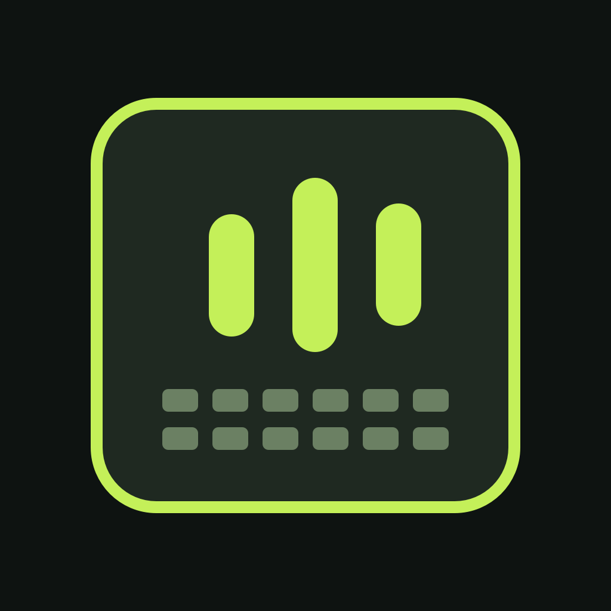

# TouchDeck



Use your iPad as a full-screen trackpad and shortcut keyboard for your Mac. TouchDeck now includes a native SwiftUI iPad app and a Safari web version. A small companion on the Mac turns paired input into native mouse, scroll, and keyboard events.

## Native iPad app

Open `TouchDeck.xcodeproj` in Xcode and select the **TouchDeck** target. Choose your Apple development team under **Signing & Capabilities**, connect your iPad, then select it as the run destination and press **Run**. Xcode will sign and install the app for that iPad. The app is iPad-only and supports all orientations.

The project is generated from `project.yml` with XcodeGen. To regenerate it after project setting changes, run `xcodegen generate`.

To build the iPad Simulator app from Terminal:

```sh
xcodebuild -project TouchDeck.xcodeproj -scheme TouchDeck \
  -destination 'platform=iOS Simulator,name=iPad Pro 11-inch (M5)' \
  -derivedDataPath build/DerivedData CODE_SIGNING_ALLOWED=NO build
```

The app asks for the Mac IP address and the current six-digit pairing code at first launch. Start the Mac companion below first.

## Start the Mac companion

1. On the Mac, install Python 3 if it is not already available.
2. Open `run.command` (or run it from Terminal). The first launch installs the two Python packages it needs.
3. The Terminal window prints an address such as `http://192.168.1.24:8765` and a six-digit pairing code.
4. Keep both devices on the same Wi-Fi. In the native iPad app, enter the printed **Mac Address** (IP only, no port) and pairing code. For the browser version, open the printed Safari address instead.
5. The first time you move or click, macOS may ask for Accessibility permission. Allow the Python/Terminal app running TouchDeck in **System Settings → Privacy & Security → Accessibility**, then reconnect if needed.

Keep the companion running while you use the iPad. Press Control-C in Terminal to stop it. The pairing code changes every time it starts. The page and input connection stay on your local network; no account is used.

## Controls

- Choose **Trackpad**, **Combined**, or **Keyboard** at the top of the native app. The selected mode is remembered. Keyboard mode uses a compact US ANSI Mac layout with staggered rows, F1–F12, symbol legends, wide Return/Shift/Delete keys, a full spacebar, and inverted-T arrows. Key widths scale together in portrait and landscape.
- In Keyboard mode, tap modifiers to latch them; Shift applies to the next key. Caps Lock controls letter capitalization within TouchDeck, including Shift inversion, without changing the Mac's hardware Caps Lock state. Key legends assume a US input layout on the Mac.
- One finger moves the Mac cursor; tap to click.
- Adjust **Pointer speed** above the touch surface in Trackpad or Combined mode, from **0.25× to 3×**. It applies immediately to movement and dragging, is saved on the iPad, and leaves scrolling and gesture thresholds unchanged. **Reset** restores the original 1× speed.
- Hold one finger still for about half a second, then move to drag. Lift to drop.
- Two fingers scroll; a two-finger tap right-clicks.
- Scrolling is reversed on both axes and smoothed on the Mac at a target 120 updates per second. A flick continues with decaying momentum; touching the pad again stops it. Slow movement retains fractional deltas. The Mac companion must be restarted after this update.
- Pinch sends Command–Plus/Minus zoom shortcuts in compatible Mac apps.
- Move three fingers to drag (place the Mac pointer over a window's title bar to move that window); lift to drop.
- Four fingers swipe left/right to change desktops, up for Mission Control, or down for App Exposé. These use macOS Control–Arrow shortcuts; custom shortcut settings can change their behavior.
- Open **Gesture guide** above the trackpad for a reminder. Multi-finger gestures are captured within the trackpad surface.
- The live label on the trackpad shows the detected finger count and recognized action. **Gesture guide → Test Mac actions** sends the same Control–Arrow shortcuts directly, helping distinguish touch recognition from Mac shortcut settings.
- The native trackpad opts out of iPadOS editing gestures and requests priority for screen-edge gestures. This does not disable every system gesture; begin multi-finger gestures inside the trackpad, away from screen edges.
- The quick keys send arrows, Delete, Return, Space, Escape, and Tab.
- Tap a modifier, then a shortcut key. Tap the modifier again to release it.
- Type into the message field and tap **Send** to enter text using the Mac’s active input source.
- Mission Control and Desktop send Control–Up and F11 respectively. The companion includes the macOS function-key event flag for navigation and function keys so system shortcuts can recognize them.

The Mac companion must be restarted after updating it to enable hold-and-drag. Held mouse buttons and keys are released when the connection closes. The native app also releases input when switching modes or leaving the app.

## Notes

TouchDeck uses ports 8765 (the web page) and 8766 (paired input). If macOS asks whether Python may accept incoming connections, allow it on your private network. The six-digit code is a convenience for pairing on a trusted local network, not an internet-facing security boundary. Do not forward these ports from your router.

The iPad web app can be added to the Home Screen from Safari for a full-screen launch. A native iOS app is not required.

## App icon

The app icon is included in the asset catalog. To regenerate its original geometric artwork on a Mac, run `swift scripts/generate-icon.swift` from the repository root.
